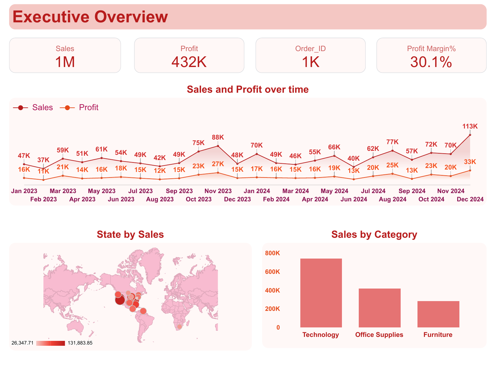

# Sales & Customer Analytics Dashboard

A **Google Looker Studio** dashboard giving a 360° view of sales performance, product profitability, and customer and operations metrics for 2023–2024.

## 📊 Overview

The dashboard has three pages:

1. **Executive Overview**: high-level KPIs and trends
2. **Product Deep Dive**: category and product-level performance
3. **Customer & Operations**: customer segments, shipping, and top customers

---

## 1️⃣ Executive Overview

**Key metrics**

| Metric | Value |
|---|---|
| Sales | 1M |
| Profit | 432K |
| Order_ID (order count) | 1K |
| Profit Margin % | 30.1% |

**Visuals**
- **Sales and Profit over time**: line chart of monthly sales and profit, January 2023 to December 2024
- **State by Sales**: map showing where sales are concentrated, scaled from about 26K to about 132K
- **Sales by Category**: bar chart comparing Technology, Office Supplies and Furniture

---

## 2️⃣ Product Deep Dive

**Visuals**
- **Sales & Profit by Product Category**: horizontal bar chart across 10 categories (Machines, Phones, Copiers, Accessories, Storage, Art, Bookcases, Paper, Chairs, Others)
- **Top 10 Most Profitable Products**: table with product name, profit, discount and sales, sorted by profit
- **Top 10 Products by Quantity**: line chart of units sold per product
- **Sales by Category**: donut chart (Technology 51.5%, Office Supplies 28.9%, Furniture 19.6%)
- **Top 10 Products by Profit**: bar ranking, led by Accessories Model 1 (34.2K)

---

## 3️⃣ Customer & Operations

**Key metrics**

| Metric | Value |
|---|---|
| Total Customers | 150 |
| Average Order Value | 1197 |

**Visuals**
- **Sales by Shipping Mode**: bar chart (Standard, Second, First, Same Day)
- **Orders by Shipping Mode**: donut chart (Standard Class 55.6%, Second Class 21.3%, First Class 13.5%, Same Day 9.7%)
- **Sales by Customer Segment**: donut chart (Consumer 54.5%, Corporate 27.7%, Home Office 17.8%)
- **Top 10 Customers by Sales**: table with customer name, sales, profit and order count

---

## 📅 Reporting Period

January 2023 to December 2024.

## 📁 Files in this repository

| File | Description |
|---|---|
| `Sales_And_Customer_Analytics_Dashboard.pdf` | Full 3-page report exported from Looker Studio |
| `executive-overview.png`, `product-deep-dive.png`, `customer-operations.png` | Pictures of each page |
| `index.html` | Project page for this repository |

## 🛠️ Built with

- Google Looker Studio

## 👩‍💻 Author

Created by **Sana Naik**, First Year Computer Engineering, Shri Anandrao Abitkar College of Engineering, Pal.
